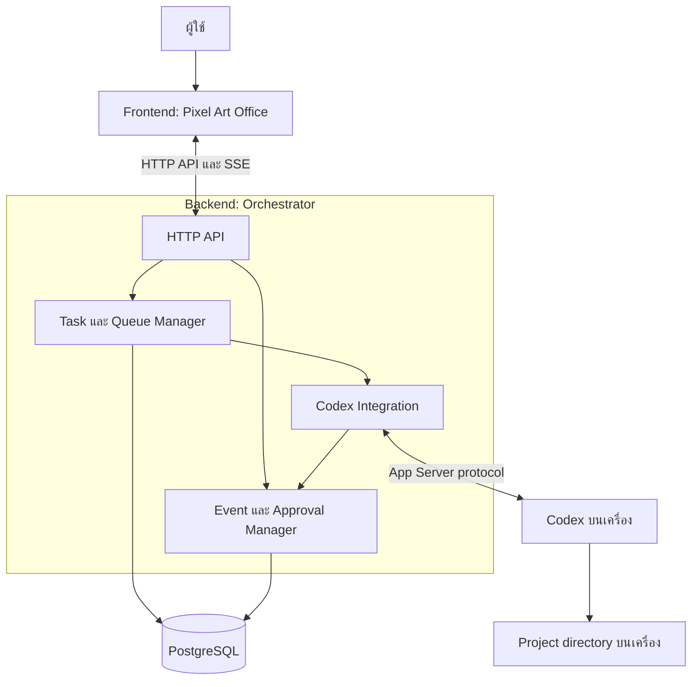

# Architecture

## เป้าหมายและสถานะ

Pixel Agent Office เป็น Local-first Web App สำหรับผู้ใช้คนเดียวบน macOS ใช้ Pixel Art Office แสดงสถานะการทำงานจริงของ Coding Agent โดย V1 เริ่มจาก Codex และเก็บประวัติใน PostgreSQL

ระบบปัจจุบันใช้ Go Backend บน host, React + TypeScript + Vite Frontend และ PostgreSQL ผ่าน Docker Compose ตามตัวเลือกของผู้ใช้ Backend เรียก Codex App Server บนเครื่องและให้บริการ Frontend build ผ่าน local HTTP รายละเอียด behavior ให้ยึด feature spec ของแต่ละ version

## ภาพรวม

ใช้ Modular Monolith: Backend เป็น local service เดียวที่แบ่งหน้าที่เป็น modules ภายใน ไม่ต้องเริ่มด้วย Microservices

## ความรับผิดชอบ

- **Frontend:** เลือกโปรเจกต์ ส่งงาน ดู task และ events ตอบ approval และแสดงฉาก Pixel Art; animation อ้างอิงสถานะที่ Backend ส่งจริง
- **HTTP API:** ตรวจ input และการเข้าถึง local service รับคำสั่งจาก Frontend และส่ง snapshot กับ events กลับ
- **Task และ Queue Manager:** จัดการ task lifecycle และคิว; V1 มี active task สูงสุดหนึ่งงานต่อ project และใช้ PostgreSQL บันทึกสถานะ
- **Event และ Approval Manager:** บันทึกและเผยแพร่ events; ส่งต่อ approval เฉพาะเมื่อ integration รองรับ โดยไม่อนุมัติแทนผู้ใช้
- **Codex Integration:** เริ่มและติดตามงานผ่าน Codex แปลงข้อมูล runtime เป็น task events และจัดการ cancellation; ใช้ App Server และแปลงเฉพาะ events ที่ runtime ส่งมา
- **PostgreSQL:** เก็บ projects, tasks, events และ approvals แบบ persistent; status กับ event ที่เกี่ยวข้องต้องบันทึกแบบ atomic ตาม Backend spec

โค้ด Backend แบ่งเป็น `internal/server` สำหรับ HTTP/SSE, `internal/orchestrator` สำหรับ worker และ runtime coordination, `internal/store` สำหรับ PostgreSQL และ `internal/codex` สำหรับ App Server ส่วน `internal/antigravity` เป็น integration ทดลองที่ยังไม่เปิดใช้ใน production

## การทำงานหลัก

1. ผู้ใช้เลือก project ที่ลงทะเบียนแล้วและส่ง prompt ผ่าน Frontend
2. Backend ตรวจ input และ project บันทึก task สถานะ `queued` แล้วจัดคิวตาม project
3. Backend เริ่ม Codex เมื่อถึงคิว และบันทึกสถานะกับ events ที่ runtime รายงานจริง
4. Frontend รอ SSE ready แล้วโหลด snapshot ผ่าน HTTP และ reconcile buffered events ตาม Backend และ Frontend spec
5. หาก runtime รองรับ approval Backend ส่งคำขอให้ผู้ใช้ตัดสินใจ; เมื่อสำเร็จ ล้มเหลว หรือยกเลิก จึงบันทึกผลตามสถานะจริง

การ cancel ไม่ย้อนการแก้ไขไฟล์ที่เกิดขึ้นแล้ว และการระบุ project directory ไม่ใช่ filesystem sandbox

## Local deployment

รัน PostgreSQL ผ่าน Docker Compose พร้อม persistent volume และรัน Backend บน host เพื่อเข้าถึง Codex, authentication และ project directory บนเครื่อง ส่วน Frontend ติดต่อ Backend ผ่าน local HTTP service

หากต้องการรัน Backend ใน container ให้พิสูจน์การเข้าถึง runtime, project, credentials และขอบเขต filesystem ก่อน; ไม่สมมติว่า container เข้าถึง host ได้เอง เก็บ credentials นอก source control และตรวจ Host, Origin และ authentication ตาม Backend spec

## Workflow และหลาย provider

Workflow แบบ sequential บันทึก step และ task ใน PostgreSQL แล้วส่งผลลัพธ์ของขั้นก่อนเป็น input เพิ่มให้ขั้นถัดไป โดยใช้คิว FIFO เดียวกับ task ปกติใน project เดียวกัน การ fail/cancel หยุดขั้นถัดไปและ restart ไม่ replay งานที่เริ่มแล้ว ดูรายละเอียดที่ [Workflow contract](backend-specs/v2/workflow-contract-draft.md)

Backend เปิด Codex และลงทะเบียน Antigravity เมื่อพบ image OAuth ของแอปและ session volume ที่มี label ตรงกัน; ตรวจ Docker daemon identity และยึด image digest ตลอด execution API ปฏิเสธ provider ที่ unavailable และไม่มี automatic fallback Workflow Codex → Antigravity ผ่าน HTTP/PostgreSQL และ providers จริงด้วยข้อความสังเคราะห์แล้ว Claude ถูกเลื่อนตามคำขอผู้ใช้

Antigravity executor ทดลองใช้ Docker container แยก PID namespace, image digest และ execution identity ที่บันทึกก่อนสร้าง container; recovery ต้องตรวจ daemon/ownership และยืนยันว่าหยุดแล้วจึงปลดคิว ผู้ใช้อนุญาต Docker bridge แล้วเมื่อ 2026-10-29; container ใช้ `--network bridge` และตรวจ configuration ก่อนรัน ทดสอบ HTTPS ไปยังเว็บไซต์ Antigravity ผ่านแล้ว และยืนยัน OAuth/model response จริงจาก container แล้ว Session อยู่ใน named volume แยกจาก project และไม่ส่ง API key; entrypoint ตั้ง `useG1Credits:false` แบบ atomic ทุกครั้ง Worker ลบเฉพาะ container ที่หยุดแล้วหลัง commit terminal state โดยเก็บ auth volume ไว้ ดูหลักฐานและข้อจำกัดที่ [Antigravity integration notes](backend-specs/v2/antigravity-integration-notes.md)

Frontend แสดง provider, availability และ capabilities จาก Backend ส่วนตัวละครแสดงสถานะของ task ที่เลือก Subagent visibility ใช้เฉพาะ metadata ที่ runtime ส่งมา

## ขอบเขตการยืนยัน

HTTP/store/worker tests ใช้ PostgreSQL และ runtime จำลอง รวม FIFO, cancellation races, recovery, approvals และ SSE reconciliation; มี opt-in smoke tests สำหรับ Codex จริงตาม [README](../README.md) Browser ตรวจ UI ด้วย responses จำลองและเคยทดสอบ flow กับ Codex จริงตามบันทึกใน README

Antigravity ใน container ยืนยัน OAuth, model result, cancellation ระหว่างเริ่ม container และ mixed workflow จริงแล้ว ส่วน cancellation ขณะ subprocess แยก process group ทำงานทดสอบด้วย Docker/runtime จำลอง ไม่ใช่การทดสอบ tool ของ model จริง การตรวจ readiness เมื่อเริ่ม Backend ไม่รับประกันว่า session หรือ quota จะยังใช้ได้ทุกครั้ง การกู้คิว Codex หลัง boot session เปลี่ยนทดสอบด้วย identity จำลอง ยังไม่ได้รีสตาร์ตเครื่องจริง และยังไม่ได้ตรวจด้วย screen reader จริง

## เอกสารที่เกี่ยวข้อง

- [Backend Feature Specifications](backend-specs/README.md)
- [Frontend Feature Specifications](frontend-specs/README.md)
